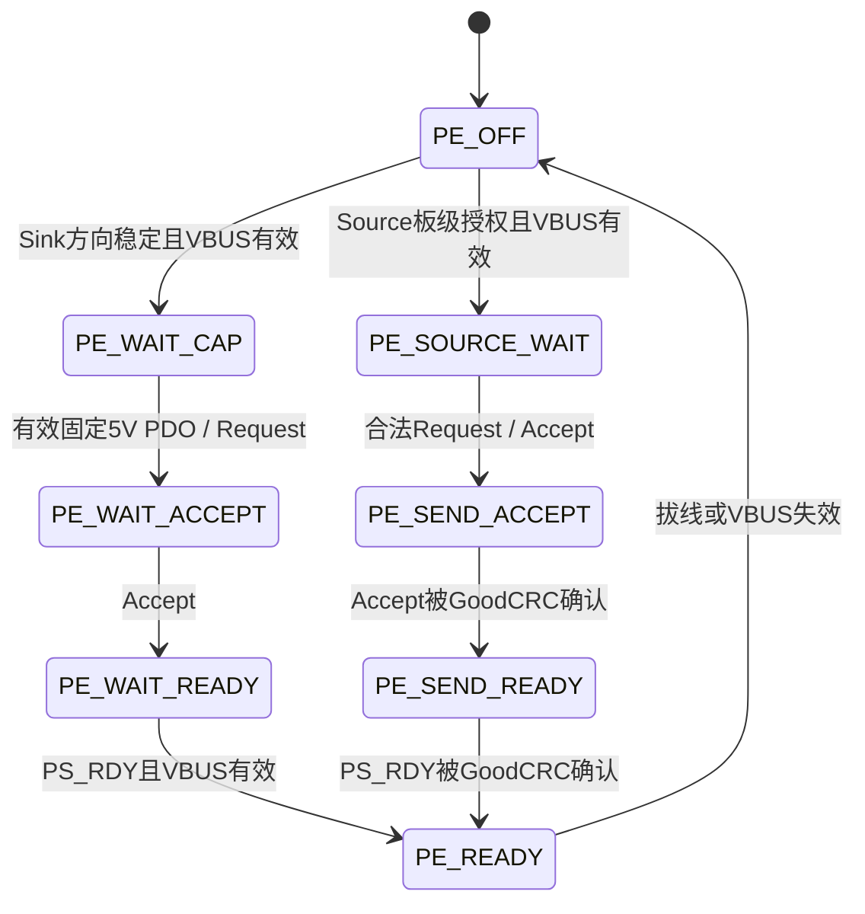

# 协议、角色与状态机

这是受资源限制的 PD/DP Alt Mode 实验固件。协议核心与 Mock/CH543 HAL 分离；状态和报文字段由同一份 `src/pd.c`、`src/dp.c` 实现。PC 仿真只能验证这些软件路径，不能证明 CC 电气、GoodCRC 时限、MUX 布线或视频链路可用。支持范围及未完成项见 [STATUS.md](STATUS.md)。

## 三种角色分别保存

| 字段 | 值 | 作用 |
|---|---|---|
| `pd.power_role` | 0 Sink / 1 Source | SOP PD Header Power Role、电源协商；是否允许驱动 VBUS 还必须经板级授权 |
| `pd.data_role` | 0 UFP_U / 1 DFP_U | SOP PD Header Data Role；本工程 PD2.0 Structured VDM 的发现、进入及配置发起权 |
| `pd.video_role` | 1 DFP_D / 2 UFP_D | DP 视频源/接收端能力、Status Connection、HPD 方向、外部 MUX 角色 |

初次连接的数据角色由电源角色决定，成功的 DR_SWAP 只改变数据角色。选择 DP Source 不会自动打开 VBUS，也不会自动成为 USB DFP。默认目标板是电源 Sink；同一固件仍可选择 DP Source 或 DP Sink，但对端必须具有互补的视频能力与兼容的供电连接。

运行时 `pd_set_video_role()` 只接受拔线状态下的角色变更；插着线时返回 0。`pd_request_data_swap()` 用于合同建立后、尚未进入模式时的数据角色交换。当前没有自动发起 DR_SWAP 的应用策略；USB UFP 会等待 USB DFP 发起发现。不能用修改 Header Data Role 来替代真实 DR_SWAP。

PD 与 DP 角色区分、显式电源合同前置条件见 [ST TA0356 §2](https://www.st.com/resource/en/technical_article/dm00479305-usb-type-c-and-power-delivery-displayport-alternate-mode-stmicroelectronics.pdf)。

## 报文边界

实现发送 PD2.0 Header（Revision=1）、SVDM1.0 Header（Version=0），仅处理 SOP 非扩展报文，最多 7 个 Data Object。多字节字段在字节缓冲中按 little-endian 编解码，不依赖 C 位域布局。

| 字段 | 实现值或位置 |
|---|---|
| PD Header | Type[4:0]、Data Role[5]、Revision[7:6]、Power Role[8]、Message ID[11:9]、NDO[14:12] |
| Structured VDM Header | SVID[31:16]、Structured[15]=1、Version[14:13]=0、Object Position[10:8]、Command Type[7:6]、Command[4:0] |
| Discover Identity / SVIDs | SVID `0xFF00`，Object Position=0，Command=1 / 2 |
| Discover Modes | SVID `0xFF01`，Object Position=0，Command=3 |
| Enter / Exit / Attention | SVID `0xFF01`，当前模式 Object Position，Command=4 / 5 / 6 |
| DP Status / Configure | SVID `0xFF01`，当前模式 Object Position，Command=16 / 17 |
| Command Type | Initiator=0、ACK=1、NAK=2、BUSY=3 |

DP Mode 的 Capability 编码与 Status 的 Connection 编码不同：Mode UFP_D=1、DFP_D=2；Status DFP_D=1、UFP_D=2。不能直接复制这两个字段。Configure[1:0] 指定 **USB UFP 接收方** 的视频角色：1=DFP_D、2=UFP_D、0=USB 配置；不是“本地总是 Source/Sink”。

Mode[5:2]、Configure[5:2] 仅使用传统 DP signalling=1。Mode bit6 声明插座，DFP_D/UFP_D pin 位图分别在 [15:8]/[23:16]；处理对端插头能力时交换读取的 pin 字段。Status 保存 Connection[1:0]、Enabled[3]、Multi-function preference[4]、USB configuration request[5]、Exit[6]、HPD[7]、HPD IRQ[8]。IRQ=1 且 HPD=0 属于非法组合。字段依据：[Linux typec_dp.h](https://github.com/torvalds/linux/blob/master/include/linux/usb/typec_dp.h)、[Linux pd_vdo.h](https://github.com/torvalds/linux/blob/master/include/linux/usb/pd_vdo.h)。

Status[6:2] 仅由 USB UFP 向 DFP 声明，USB DFP 发送时清零；HPD[8:7] 仅由 DP Sink 向 DP Source 声明。这两个方向约束分别依赖 USB 角色和视频角色，不能混用。[ST TA0356 Table 8 注2、注3](https://www.st.com/resource/en/technical_article/dm00479305-usb-type-c-and-power-delivery-displayport-alternate-mode-stmicroelectronics.pdf)

`PRODUCT_VID/PID` 默认为 0，是实验占位符；不是分配给项目的 USB 标识。量产前需要合法身份、适当的 Product Type/USB capability 声明和合规复核。

## 电源与传输

Sink 只请求第一个固定 5 V PDO，电流为对端声明与 `PD_CURRENT_10MA` 两者的较小值。显式合同必须等 Accept、PS_RDY 和真实 VBUS 检测成立后才置位。软件 Source 策略供 Mock 和将来的独立板级移植使用；参考 CH543 板级 HAL 禁止供电 Source，不具备完整 Source Hard Reset 电源恢复序列。

发送缓冲在等待 GoodCRC 时保持不变，重传保持 Message ID；只有匹配 GoodCRC 后 ID 按 modulo 8 增加。接收重复 Message ID 仍由 PHY 回复 GoodCRC，策略层不再次处理。PD Header 长度、扩展位、版本与角色冲突在策略入口检查。PHY 应仅递交 SOP 且 CRC 正确的报文；具体 CRC/中断/DMA 约束见 [AUDIT.md](AUDIT.md)。

`pd_poll()` 使用 16 位毫秒计时；超时差值按回绕方式比较，间隔必须小于 32768 ms。应用必须持续调用，不能加入日志长延时或等待 MUX 完成的忙循环。1 ms tick 的量化误差和 PHY ISR 时间都需要真实设备测量；测试中的时间推进不代表实际时序符合 USB PD。

## USB DFP 发起路径

| 当前状态 | 发送或等待 | 有效 ACK 后 |
|---|---|---|
| `DP_DISC_ID` | Discover Identity | 确认 Modal Operation，进入 `DP_DISC_SVID` |
| `DP_DISC_SVID` | Discover SVIDs | 找到 `0xFF01` 后进入 `DP_DISC_MODE`；最多读取 4 页 |
| `DP_DISC_MODE` | Discover Modes | 选择互补视频角色且有共有 pin 的模式对象，进入 `DP_ENTERING` |
| `DP_ENTERING` | Enter Mode | `entered=1`，进入 `DP_STATUS_WAIT` |
| `DP_STATUS_WAIT` | DP Status Update | 解析对端状态、确定 pin，进入 `DP_CONFIG_WAIT` |
| `DP_CONFIG_WAIT` | DP Configure | 仅在有效 ACK 后启用 AUX/MUX，进入 `DP_ACTIVE` |
| `DP_ACTIVE` | Attention / Status / 本地退出请求 | 更新 HPD；USB 请求发送 Configure=0；退出请求先 Configure=0 ACK，再进入 `DP_EXITING` |
| `DP_EXITING` | Exit Mode | ACK 后清除 `entered`，回到 `DP_IDLE`；不自动立即重新进入 |

响应必须匹配待处理的 SVID、Command、Object Position 与预期 DO 数量。BUSY 延后 `VDM_BUSY_DELAY_MS`（50 ms）重试，最多 `VDM_BUSY_RETRIES`（3）次；NAK、格式错误或超时进入失败状态并关 MUX。VDM 计时从请求的 GoodCRC 到达后开始，不把“PHY 发射完成”当作对端收到。普通 VDM 使用 30 ms，Enter/Exit 使用单独的 45 ms 模式计时。Status 的 BUSY 重试保留尚未成功传递的 HPD IRQ。

Pin 取双方支持集合的交集。双方偏好多功能且 D 可用时选 D；否则按 C、E、D 选一个 bit。C/E 为 4-lane DP，D 为 2-lane DP + USB3。`LOCAL_PINS` 必须与板上实际线路一致，不能仅因代码支持就声明 PCB 支持全部 C/D/E。

## USB UFP 响应路径

UFP 等待 Discover Identity/SVIDs/Modes；本地暴露一个 DP Mode。Enter Mode 接受 Object Position=1。Enter ACK 只表示协议模式进入，不允许先切高速 MUX。Status 响应携带当前视频角色、HPD 和配置状态。

收到 Configure 时先校验角色、signalling、单一 pin 和本地能力。合法 DP Configure 的 ACK 还必须得到对端 GoodCRC，才执行 `AFTER_CONFIG` 并启用 MUX/AUX。合法 Configure=0 回到 USB/安全配置但保留模式进入记录。Exit Mode 支持当前模式以及 Object Position=7 的退出全部模式请求；ACK 确认后清状态。Attention 不返回 VDM ACK/NAK，但和其他 PD 数据消息一样需要 GoodCRC。只有 USB UFP 发送 Attention；USB DFP 的状态变化通过 DP Status Update 交换。

## HPD、异常与恢复

DP Sink 从 `dp_hpd_get()` 和已锁存的 `dp_hpd_irq_get()` 获取本地显示接收端状态：若为 USB UFP，发送 Attention；若为 USB DFP，发起带最新状态的 DP Status Update。后者收到正常 Status ACK 时保持现有配置，不重新执行 Configure。DP Source 既可从响应/Attention，也可作为 USB UFP 从 Status request 得到 HPD，并交给 `dp_hpd_set()` 产生电平/IRQ 脉冲。USB 数据角色不决定 HPD 方向。[ST TA0356 §4.4、§4.6](https://www.st.com/resource/en/technical_article/dm00479305-usb-type-c-and-power-delivery-displayport-alternate-mode-stmicroelectronics.pdf)

尚未完成有效配置时，不得把 HPD 拉高到本地视频源。成功配置先接高速 MUX，再接 AUX；DP Source 保持 HPD 低 **4 个 1 ms tick** 后才应用保存的 HPD/IRQ，补偿一个 tick 的量化误差，目标是满足至少 3 ms 的断开识别时间。期间新的 HPD 高电平保留待发送 IRQ，HPD 低电平清除 IRQ。该软件顺序已实现，实际时钟精度及引脚时序仍必须测量。

模式进入记录与硬件配置状态分开：VDM 超时不能假装对端已经退出。失败时保留必要的 `entered` 状态；Exit ACK、Hard Reset 或拔线才完整清除。运行中的模式不能通过 DR_SWAP 悄悄改变数据角色。

Soft Reset 用于协议层恢复，重置 Message ID 和重新建立电源合同，保留 DP 模式及已有硬件配置；它不等同于拔线或 Exit Mode。传输重试耗尽时先发 Soft Reset；Soft Reset 未得到接受或其传输再次失败时升级 Hard Reset。PHY 没有产生 TX_END 时另有 5 ms 上限，不能无限保持发送中。

Hard Reset 清除模式和合同、恢复默认数据角色并关断 MUX/AUX/HPD；参考 Sink 等待供电端重新恢复。恢复等待明确区分“尚未观察到 VBUS 低”和“已经观察到低、等待恢复”两阶段，在总计 1000 ms 内允许 VBUS 暂降及因此产生的方向读数为零，保留连接方向。新 Source_Capabilities 或低后恢复可结束保护；超时后恢复通常的拔线判断。模式已进入时收到 DR_SWAP 也触发 Hard Reset。完整电源转换、复位次数与所有 PD policy 状态仍需产品级扩展。

Linux 的 [displayport.c](https://github.com/torvalds/linux/blob/master/drivers/usb/typec/altmodes/displayport.c) 用于交叉检查配置前安全态、待配置 HPD/IRQ 及 USB 配置/退出请求的区分；代码为本工程独立实现。取得与尚缺的规范证据见 [AUDIT.md](AUDIT.md)，不以参考实现代替规范认证。

## 异步 MUX 提交（Board2）

Configure 的 ACK 条件满足后进入 `DP_MUX_WAIT`，`dp_mux_set()` 只提交路由请求；主循环先处理新收到的拔线/Reset/Exit，再执行一次 `hal_poll()`。HAL READY 才转 `DP_ACTIVE`，并开始 Source HPD 的 4 ms 低电平防护。等待期间收到的 HPD IRQ 会保留，不因后续只有高电平的 Attention 丢失。HAL FAULT 或 100 ms 超时转 `DP_FAILED/ERR_HARDWARE`。Soft Reset 保留已协商且等待硬件完成的模式。

`pd_safe()` 取消所有未完成的路由；协议上的安全状态不代表失效 I²C 总线下物理开关必然关闭，详见 [BOARD2](BOARD2.md)。参考 GPIO HAL 立即返回 READY，通用协议测试另有延迟/超时/故障注入。

## Sink 的 HPD 与异步 MUX 就绪

物理显示器 HPD 先高时，DP Status/Attention 不能让主机在本端通路未就绪时开始 AUX 访问。本实现只在 `DP_ACTIVE` 发布 Sink HPD 高，`DP_MUX_WAIT`/失败/未配置期间发布低，丢弃配置前的 IRQ。CH9445 的全部路由读回完成后，UFP 发送 Attention，DFP 视频 Sink 发送 Status Update。该策略保留连接角色字段，不阻止对端在 HPD 低时发起 Configure。详见 [复现与修复](DIAGNOSTIC.md)。
